# Copilote RUN — guide d'utilisation et de prise en main

Ce guide s'adresse à l'équipe RUN. Il explique comment se servir de l'application au
quotidien, sans connaissance technique. Une vidéo de 7 minutes reprend le même parcours :
[tutoriel_copilote_run.mp4](tutoriel_copilote_run.mp4).

## 1. L'essentiel en une minute

L'application lit vos tickets Jira et répond à quatre questions :

| Question | Où regarder |
|---|---|
| Quels problèmes reviennent, et combien coûtent-ils ? | Tableau de bord, Problèmes récurrents |
| Y a-t-il une semaine anormale ? | Bandeau d'alerte, Pics et alertes |
| Ce nouveau ticket est-il déjà connu ? | Nouveaux tickets |
| Que faut-il traiter en premier, et comment ? | Copilote, Plans d'action |

Trois principes à garder en tête :

- **Le code calcule.** Tous les chiffres viennent du moteur d'analyse, pas de l'intelligence
  artificielle.
- **Le copilote rédige.** Il explique et propose, en citant les tickets sur lesquels il s'appuie.
- **Vous validez.** Aucune action n'est exécutée automatiquement, et l'application ne modifie
  jamais Jira.

## 2. Ouvrir l'application

Ouvrez un navigateur à l'adresse **<http://localhost:8000>** (ou l'adresse que vous a donnée
la personne qui a installé l'application). Si la page ne répond pas, l'application n'est pas
démarrée : voir le fichier `README.md`, rubrique « Lancement ».

À l'ouverture, un bandeau bleu « Analyse en cours » peut s'afficher quelques secondes. Les
pages se remplissent toutes seules quand l'analyse est terminée.

## 3. Lire le tableau de bord

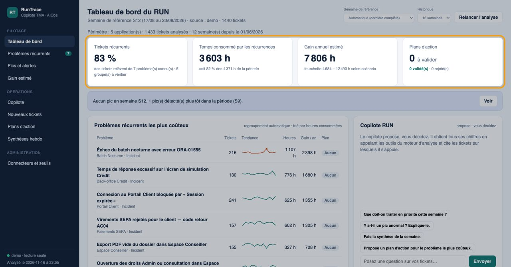

Les quatre cartes du haut résument la période analysée :

- **Tickets récurrents** : la part des tickets qui relèvent d'un problème connu.
- **Temps consommé par les récurrences** : les heures passées sur ces problèmes.
- **Gain annuel estimé** : les heures économisables par an si l'on traitait leurs causes.
- **Plans d'action** : le nombre de plans qui attendent votre décision.

En dessous, le tableau **Problèmes récurrents les plus coûteux** classe les problèmes par
heures consommées. Cliquez sur une ligne pour ouvrir sa fiche.

Dans le menu de gauche, les pastilles colorées signalent ce qui demande votre attention :
nombre de problèmes récurrents, pics de la semaine, plans à valider.

## 4. Choisir la semaine à analyser

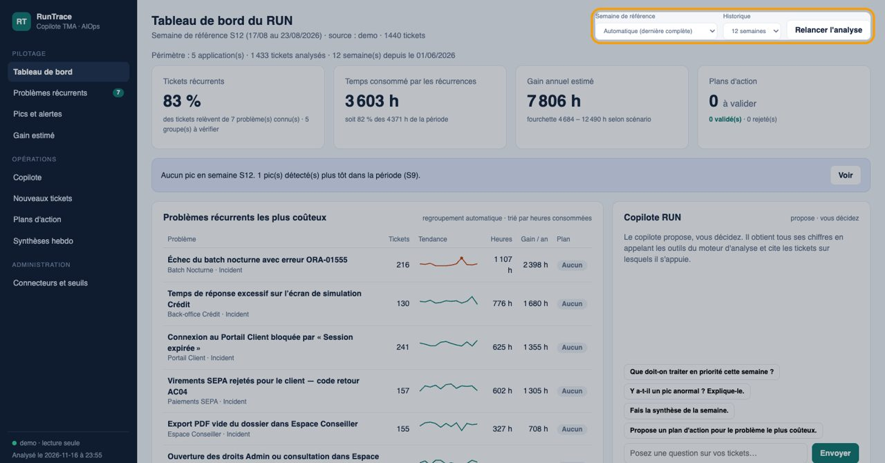

L'analyse ne dépend pas de la date du jour. En haut à droite de chaque page :

- **Semaine de référence** : l'application analyse comme si l'on était à la fin de cette
  semaine. Les tickets créés après sont ignorés. « Automatique » prend la dernière semaine
  terminée.
- **Historique** : le nombre de semaines prises en compte avant la semaine de référence
  (12 par défaut).

Changer l'un des deux relance l'analyse, en quelques secondes. Trois usages courants :

| Vous voulez… | Réglage |
|---|---|
| Faire le bilan de la semaine écoulée | Automatique |
| Suivre la semaine en cours | La semaine marquée « (en cours) » ; ses volumes sont partiels |
| Revenir sur un incident passé | La semaine de l'incident |

À noter : les numéros de problème (n° 1, n° 2…) sont réattribués à chaque analyse. Le n° 1
est toujours le plus coûteux de la période choisie.

## 5. Réagir à une alerte de pic

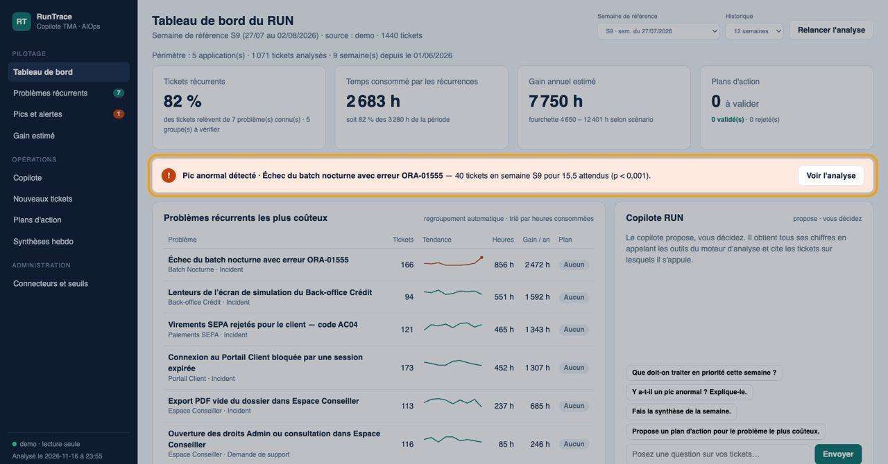

Quand un problème explose pendant la semaine de référence, un bandeau orange apparaît en
haut du tableau de bord. Cliquez sur **Voir l'analyse** pour ouvrir la page Pics et alertes.

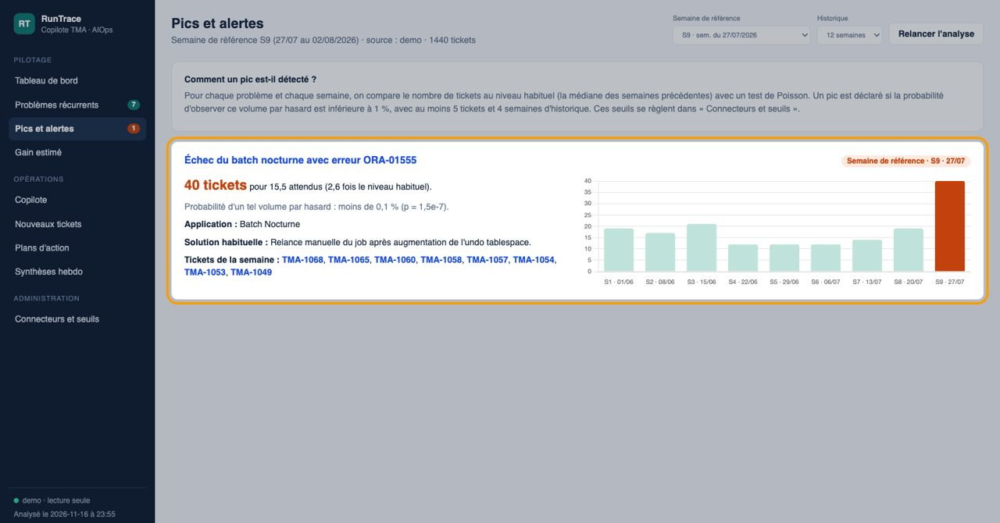

Pour chaque pic, vous lisez :

- le volume **observé** et le volume **attendu** (le niveau habituel du problème) ;
- la probabilité que cet écart soit dû au hasard ;
- la **solution habituelle** et les **tickets de la semaine**, cliquables.

Que faire ensuite : ouvrir deux ou trois tickets pour confirmer qu'il s'agit bien du même
incident, prévenir l'équipe concernée, puis demander un plan d'action au copilote si la cause
n'est pas déjà traitée.

Un bandeau bleu signifie qu'il n'y a pas de pic cette semaine, mais qu'il y en a eu plus tôt
dans la période.

## 6. Comprendre un problème récurrent

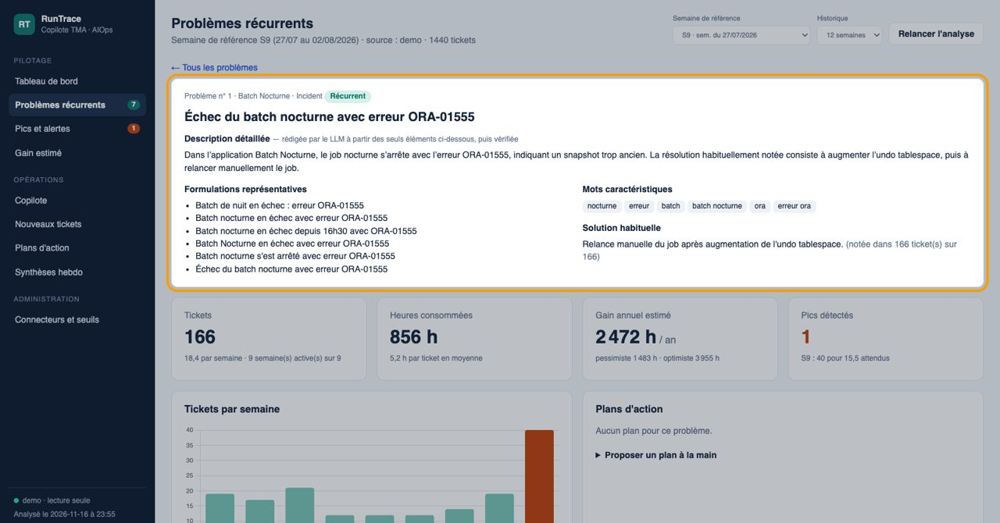

La fiche d'un problème contient, de haut en bas :

1. **Le nom et la description détaillée.** Si le nom ne suffit pas, la description explique
   ce que l'on constate et comment le problème est habituellement résolu.
2. **Les formulations représentatives** : des titres réels de tickets du groupe.
3. **La solution habituelle**, avec le nombre de tickets où elle a été notée.
4. **Les chiffres** : tickets, heures, gain estimé, pics.
5. **Le graphique** des tickets par semaine ; une barre foncée marque une semaine de pic.
6. **Les plans d'action** du problème, et un formulaire pour en proposer un à la main.
7. **La liste des tickets**. Chaque clé (par exemple TMA-1068) ouvre le détail du ticket.

### Les groupes « à vérifier »

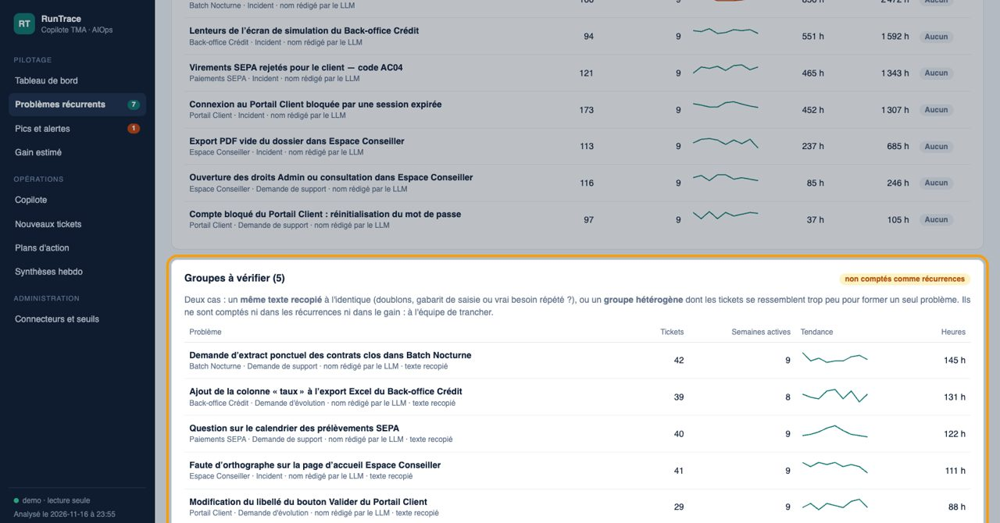

En bas de la page Problèmes récurrents, certains groupes sont marqués **à vérifier**. Ils ne
sont comptés ni dans les récurrences ni dans le gain. Deux cas :

- **Texte recopié** : tous les tickets portent le même texte. À vous de dire s'il s'agit de
  doublons, d'un gabarit de saisie, ou d'un vrai besoin répété.
- **Groupe hétérogène** : les tickets se ressemblent trop peu pour former un seul problème.

## 7. Estimer le gain

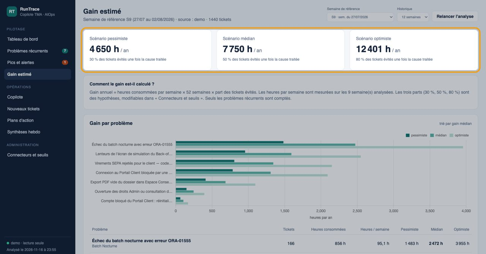

La page Gain estimé indique les heures économisables par an si l'on traitait la cause de
chaque problème, selon trois scénarios (30 %, 50 % ou 80 % des tickets évités).

Ces chiffres servent à **prioriser et à argumenter**, par exemple pour justifier un chantier
de correction. Ce ne sont pas des gains garantis. Si vos tickets n'ont pas de temps passé
renseigné dans Jira, un avertissement s'affiche et le gain est sous-estimé.

## 8. Traiter un nouveau ticket

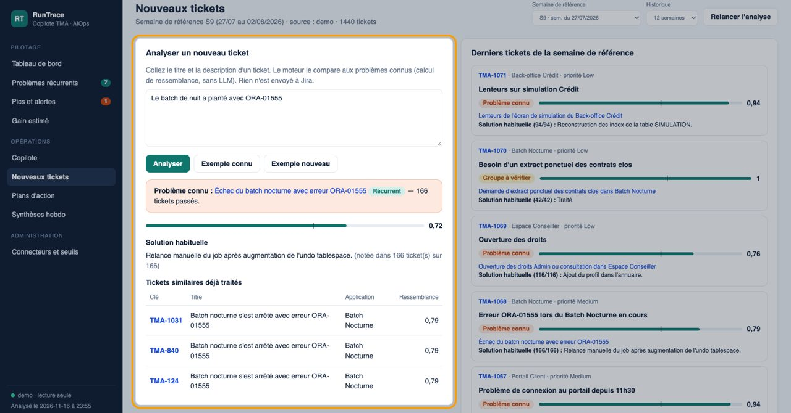

1. Ouvrez **Nouveaux tickets**.
2. Collez le titre et la description du ticket qui vient d'arriver.
3. Cliquez sur **Analyser**.

Deux réponses possibles :

- **Problème connu** : l'application indique le problème, la solution habituelle et trois
  tickets similaires déjà traités. Ouvrez-en un pour reprendre la résolution.
- **Nouveau problème** : aucun problème connu n'est assez proche. Le ticket est à traiter
  normalement.

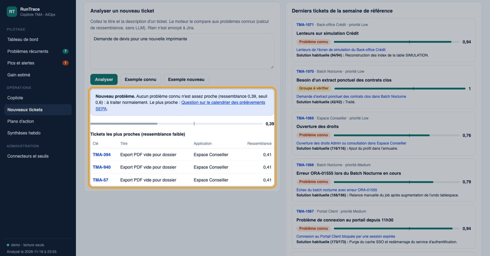

La jauge montre la ressemblance, de 0 à 1 ; le petit trait vertical est le seuil (0,6 par
défaut). Rien de ce que vous collez n'est envoyé à Jira.

La colonne de droite liste les derniers tickets de la semaine de référence, déjà classés.

## 9. Travailler avec le copilote

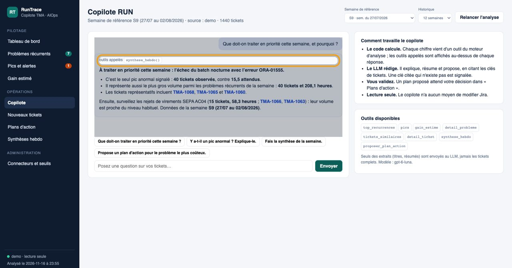

Posez votre question en français, dans la page Copilote ou dans le panneau de droite du
tableau de bord. Exemples de questions utiles :

- « Que doit-on traiter en priorité cette semaine ? »
- « Y a-t-il eu un pic anormal sur la période ? Explique-le. »
- « Fais la synthèse de la semaine 9. »
- « Combien gagnerait-on à traiter les lenteurs du back-office ? »
- « Ce ticket ressemble-t-il à un problème connu : … »
- « Propose un plan d'action pour le problème le plus coûteux. »

### Comment vérifier une réponse

| Ce que vous voyez | Ce que cela signifie |
|---|---|
| Ligne « outils appelés » au-dessus de la réponse | Les chiffres viennent du moteur d'analyse |
| « aucun outil appelé » | Réponse sans chiffre vérifié : ne vous y fiez pas pour décider |
| Clés de tickets en bleu | Tickets réels, cliquables pour vérifier |
| Avertissement orange « clé introuvable » | Le copilote a cité un ticket qui n'existe pas : ignorez cette citation |

Bon à savoir :

- Le copilote ne crée un plan d'action que si vous le lui demandez.
- La conversation n'est pas conservée : elle disparaît si vous rechargez la page.
- Si le copilote est indisponible, un message l'indique. Toutes les autres pages continuent
  de fonctionner.

## 10. Valider un plan d'action

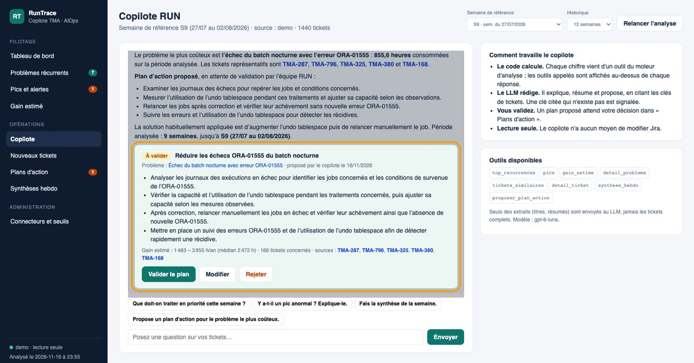

Un plan proposé apparaît dans la conversation et dans la page **Plans d'action**, à l'état
« À valider ». Le gain affiché est calculé par le moteur, pas par le copilote.

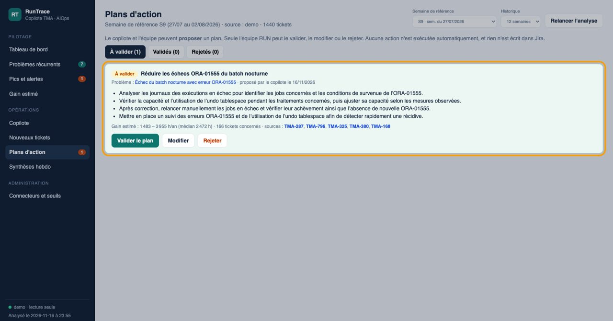

Avant de décider :

1. Relisez les actions : sont-elles réalistes pour votre contexte ?
2. Ouvrez les tickets cités en source.
3. Choisissez :
   - **Valider le plan** : il passe dans l'onglet Validés ;
   - **Modifier** : corrigez le titre, les actions, ajoutez un commentaire d'équipe ;
   - **Rejeter** : il passe dans l'onglet Rejetés.

Valider un plan **n'exécute rien** : c'est une décision enregistrée, à mettre en œuvre par
l'équipe. Un plan validé ou rejeté peut être remis « à valider ».

Vous pouvez aussi proposer un plan sans le copilote, depuis la fiche d'un problème
(« Proposer un plan à la main »).

## 11. Produire la synthèse de la semaine

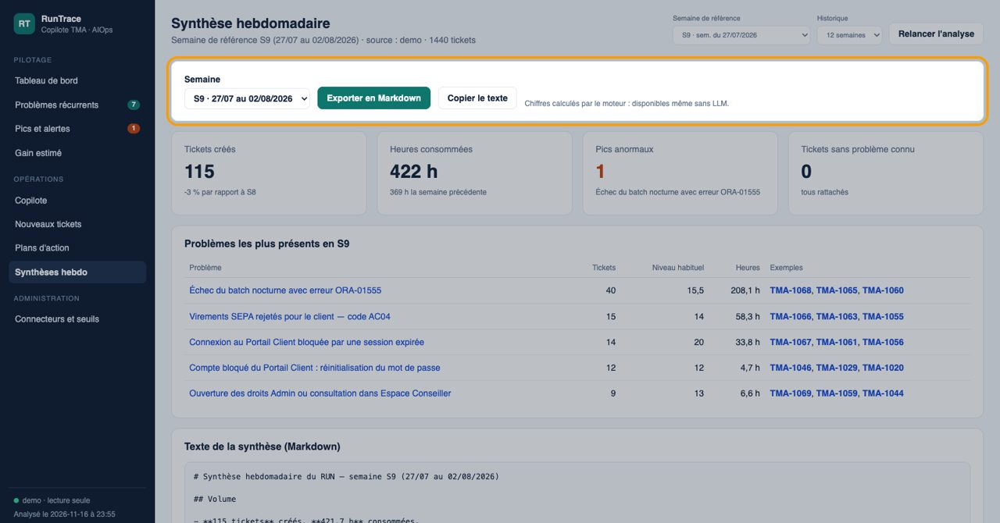

1. Ouvrez **Synthèses hebdo**.
2. Choisissez la semaine.
3. Cliquez sur **Exporter en Markdown** pour télécharger le texte, ou sur **Copier le texte**
   pour le coller dans un compte rendu ou un message.

La synthèse contient le volume, les alertes, les problèmes les plus présents, les tickets
sans problème connu et l'état des plans. Elle est produite par le moteur et fonctionne sans
intelligence artificielle.

## 12. Régler les seuils

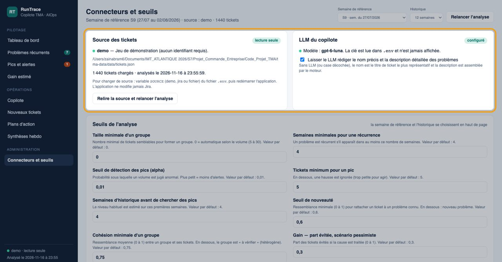

La page **Connecteurs et seuils** montre l'état de la source des tickets et du copilote, puis
les seuils de l'analyse. Chaque champ rappelle sa valeur par défaut. Ne les modifiez que si
les résultats ne correspondent pas à votre terrain.

| Ce que vous constatez | Seuil à ajuster | Dans quel sens |
|---|---|---|
| Trop d'alertes de pic | Seuil de détection (alpha) | Le diminuer |
| Un pic évident n'est pas signalé | Seuil de détection (alpha) | L'augmenter |
| Des pics signalés sur de tout petits volumes | Tickets minimum pour un pic | L'augmenter |
| Trop peu de groupes trouvés | Taille minimale d'un groupe | La diminuer |
| Trop de petits groupes | Taille minimale d'un groupe | L'augmenter |
| Des tickets rattachés à tort à un problème | Seuil de nouveauté | L'augmenter |
| Des tickets connus déclarés « nouveaux » | Seuil de nouveauté | Le diminuer |
| Le gain paraît trop optimiste | Parts évitées des scénarios | Les diminuer |

Cliquez sur **Enregistrer et relancer l'analyse** pour appliquer, ou sur **Rétablir les
valeurs par défaut** pour revenir en arrière.

Le bouton **Relancer l'analyse**, en haut de chaque page, relit les tickets à la source :
utilisez-le pour prendre en compte les tickets arrivés depuis la dernière analyse.

## 13. Routine conseillée

| Quand | Quoi | Où |
|---|---|---|
| Chaque matin | Relancer l'analyse, regarder le bandeau d'alerte | Tableau de bord |
| À chaque nouveau ticket douteux | Vérifier s'il est déjà connu | Nouveaux tickets |
| Chaque lundi | Bilan de la semaine écoulée : pics et problèmes | Pics et alertes, Problèmes récurrents |
| En point d'équipe | Demander un plan, le valider ou le rejeter | Copilote, Plans d'action |
| Chaque vendredi | Exporter la synthèse | Synthèses hebdo |
| Une fois par mois | Passer en revue les groupes « à vérifier » | Problèmes récurrents |

Règle d'or : **ouvrez les tickets cités avant de décider.**

## 14. Questions fréquentes

**La page reste sur « Analyse en cours ».**
La première analyse prend une quinzaine de secondes, davantage avec beaucoup de tickets. Si
un bandeau rouge apparaît, lisez son message et transmettez-le à la personne qui administre
l'application.

**Le chat affiche « Copilote désactivé ».**
Le modèle de langage n'est pas configuré ou ne répond pas. Tout le reste fonctionne. Prévenez
l'administrateur.

**Un problème a changé de numéro.**
C'est normal : les numéros sont réattribués à chaque analyse. Repérez un problème par son
nom, pas par son numéro.

**Le nom d'un problème a changé.**
Les noms sont recalculés à chaque analyse. Si le groupe de tickets a évolué, son nom peut
évoluer aussi.

**Les heures et le gain sont à zéro.**
Les tickets n'ont pas de temps passé renseigné dans Jira. Un avertissement jaune le signale.

**Un ticket n'apparaît pas.**
Il est peut-être en dehors de la période (après la semaine de référence, ou avant
l'historique choisi), ou sans date de création.

**Les graphiques sont remplacés par un message.**
Les graphiques ont besoin d'une connexion Internet. Le reste de la page fonctionne.

**Je me suis trompé en validant un plan.**
Ouvrez l'onglet Validés et cliquez sur « Remettre à valider ».

## 15. Petit lexique

| Terme | Sens |
|---|---|
| Problème récurrent | Groupe de tickets semblables présent sur plusieurs semaines |
| Problème ponctuel | Groupe concentré sur peu de semaines |
| Groupe à vérifier | Groupe non compté : texte recopié ou tickets trop différents |
| Pic | Semaine où un problème dépasse nettement son niveau habituel |
| Niveau habituel (attendu) | Volume médian du problème sur les semaines précédentes |
| Ressemblance | Note de 0 à 1 entre un ticket et un problème connu |
| Seuil de nouveauté | Ressemblance minimale pour dire « problème connu » (0,6) |
| Semaine de référence | Semaine à la fin de laquelle on se place pour analyser |
| Gain estimé | Heures économisables par an si la cause est traitée |
| Solution habituelle | Résolution le plus souvent notée dans les tickets du groupe |
